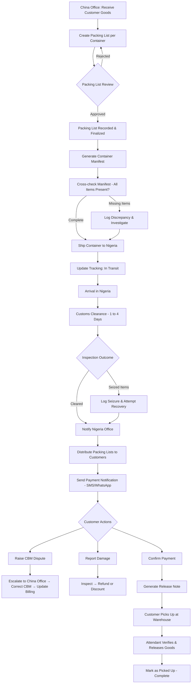

# Product Requirements Document (PRD)

## Logistics & Cargo Management System

| Field | Detail |
|---|---|
| **Document Version** | 2.1 |
| **Date** | 2 March 2026 |
| **Status** | Active — In Development |
| **Author** | — |
| **Changelog** | v2.1: Added GDPR compliance requirements (§5.8), updated user management (FR-TN-009), updated billing status values |

---

## 1. Executive Summary

This PRD defines requirements for a **Multi-Tenant Logistics & Cargo Management Platform** that digitizes the end-to-end workflow of international shipping operations. The platform is designed as a **multi-tenant SaaS application**, enabling multiple independent shipping companies (tenants) to onboard and manage their own logistics operations — each with isolated data, users, configurations, and branding. The system manages packing lists, container manifests, shipment tracking, customer billing (CBM-based), dispute resolution, customs clearance, damage claims, and warehouse pickup/release — replacing manual Excel-based and messaging-driven processes across all tenant organizations.

---

## 2. Problem Statement

Shipping companies currently suffer from:

1. **No centralized tracking** — Customers have no visibility into where their shipments are (in transit, at port, cleared, ready for pickup).
2. **Manual Excel-based manifests & packing lists** — Prone to errors, difficult to distribute, and not scalable.
3. **CBM measurement disputes** — Incorrect carton measurements lead to billing disputes with no auditable correction workflow.
4. **No structured damage/claims process** — Damage reports, inspections, refunds, and discounts are handled ad-hoc.
5. **Missing/seized goods have no formal tracking** — Items missing from containers or seized at customs are escalated informally with no logged history.
6. **Payment and release are disconnected** — Release notes are generated manually; payment confirmation and goods release lack a unified digital flow.
7. **No shared platform exists** — Each shipping company builds or cobbles together its own tools; there is no multi-tenant SaaS solution purpose-built for this China-to-Africa logistics corridor.
8. **No tenant-level isolation** — Existing solutions (where they exist) lack the ability to onboard multiple independent shipping companies with isolated data, users, and configurations.

---

## 3. Goals & Success Metrics

| Goal | Success Metric |
|---|---|
| Digitize packing list creation & distribution | 100% of packing lists generated and distributed through the system |
| Real-time shipment tracking for customers | Customers receive status updates at every stage (packed → shipped → arrived → cleared → ready for pickup) |
| Reduce CBM disputes | 50% reduction in CBM-related complaints within 6 months |
| Structured claims & dispute workflow | All damage/missing item claims logged with resolution within defined SLAs |
| Faster warehouse release | Average pickup time reduced by 30% through digital release notes |
| Multi-tenant onboarding | Onboard 5+ shipping companies within 3 months of launch |
| Tenant data isolation | Zero cross-tenant data leakage — verified via automated tests and security audits |
| Self-service tenant management | Tenant admins can configure their own users, branding, pricing rules, and notification preferences without platform intervention |

---

## 4. Users & Roles

| Role | Description |
|---|---|
| **Platform Admin (Super Admin)** | Manages the overall platform: onboards/offboards tenants, configures platform-wide settings, monitors cross-tenant health and usage |
| **Tenant Admin** | Manages a single shipping company's account: creates users, sets pricing/dollar rates, configures branding, manages notification preferences |
| **China Office Staff** | Creates packing lists, loads containers, manages manifests, investigates disputes (scoped to their tenant) |
| **Nigeria Office Staff** | Receives manifests, distributes packing lists, manages customs clearance, handles warehouse operations (scoped to their tenant) |
| **Warehouse Attendant** | Verifies release notes, checks goods, records release details (scoped to their tenant) |
| **Customer** | Views their packing list, tracks shipment, raises complaints, makes payments, picks up goods (scoped to a single tenant/shipping company) |

---

## 5. Core Features & Functional Requirements

### 5.1 Packing List Management

#### 5.1.1 Packing List Creation (China Office)

- **FR-PL-001**: System shall allow China office staff to create a packing list per container/parcel.
- **FR-PL-002**: Each packing list shall include:
  - Container number / Parcel number
  - Customer name
  - Customer contract details
  - Individual item details (description, weight from dispatch, expected weight)
  - Number of cartons
  - Carton tags / identifiers per customer
  - Tracking code for all items
  - Date items were received
- **FR-PL-003**: Each carton shall be tagged with a unique identifier linked to the customer and tracking code.
- **FR-PL-004**: All items for a single customer received on the same day shall be grouped under one tracking reference.

#### 5.1.2 Packing List Approval / Rejection

- **FR-PL-005**: Packing lists shall go through an approval workflow before being finalized.
- **FR-PL-006**: When **approved**, the packing list status changes to "Recorded" and becomes visible to downstream offices.
- **FR-PL-007**: When **rejected**, the packing list is returned for review with item-level rejection comments/complaints.
- **FR-PL-008**: Rejected packing lists must be revised and resubmitted for approval.

#### 5.1.3 Packing List Distribution

- **FR-PL-009**: Finalized packing lists shall be sent to the company's global email automatically.
- **FR-PL-010**: Nigeria office shall receive and access packing lists from the system to distribute to customers.
- **FR-PL-011**: Each customer shall receive only their own packing list (filtered view of the container manifest).

---

### 5.2 Manifest Management

#### 5.2.1 Container Manifest

- **FR-MF-001**: System shall generate a manifest per container, structured as a master document containing:
  - Container number / Parcel number
  - List of all customers with items in the container
  - Summary information per customer (number of cartons, total weight, total CBM)
- **FR-MF-002**: Clicking on a customer name within the manifest shall navigate to / generate that customer's individual packing list.
- **FR-MF-003**: The individual customer packing list (extracted from the manifest) shall be printable and sendable to the customer.

#### 5.2.2 Manifest Verification (On Arrival — China & Nigeria)

- **FR-MF-004**: On arrival at the China office, the manifest shall be used to cross-check that all items are complete and no customer names are missing.
- **FR-MF-005**: If items are found missing during cross-check, the system shall:
  - Log the discrepancy against the manifest
  - Trigger investigation into the supply and loading process
  - Record whether cartons were sent or went missing during loading
- **FR-MF-006**: If repacking occurs, it must be logged in the manifest with details of what was repacked and why.

---

### 5.3 Shipment Tracking

- **FR-TR-001**: System shall provide real-time tracking status for each customer's shipment with the following stages:

```
Received at China Warehouse → Packed in Container → In Transit →
Arrived in Nigeria → Customs Clearance → Cleared → Ready for Pickup → Picked Up
```

- **FR-TR-002**: Status updates shall be pushed to customers via SMS and/or WhatsApp.
- **FR-TR-003**: Customers shall be able to check their shipment status using their tracking code via a portal or messaging interface.
- **FR-TR-004**: Nigeria office staff shall be able to update shipment status as containers move through customs clearance (1–4 days typical).

---

### 5.4 CBM & Billing

#### 5.4.1 CBM Measurement & Pricing

- **FR-BL-001**: Each carton's CBM (Cubic Meter) measurement shall be recorded at the China office.
- **FR-BL-002**: Total CBM per customer shall be calculated automatically from individual carton measurements.
- **FR-BL-003**: Pricing shall be calculated based on:
  - Total CBM value
  - Dynamic dollar exchange rate (set at time of arrival / billing)
- **FR-BL-004**: Customers shall see their total CBM and the corresponding price. Individual CBM-to-rate breakdowns may be hidden per business rules.

#### 5.4.2 CBM Dispute & Correction

- **FR-BL-005**: Customers shall be able to raise a complaint about incorrect CBM measurements.
- **FR-BL-006**: CBM complaints shall be escalated to the China office for investigation.
- **FR-BL-007**: If a CBM error is confirmed, the system shall:
  - Record the original CBM and the corrected CBM
  - Recalculate the customer's total charge
  - Send an updated CBM and price to the customerf
- **FR-BL-008**: The system shall maintain an audit trail of all CBM corrections.

#### 5.4.3 Miscellaneous Charges

- **FR-BL-009**: System shall support a "miscellaneous / stopdown" charge — a fee paid by customers to facilitate timely container release from the wharf.
- **FR-BL-010**: This charge shall be visible to the customer as a line item in their billing summary.

---

### 5.5 Damage & Claims Management

#### 5.5.1 Damage Reporting

- **FR-DC-001**: On arrival, if packages are damaged, the system shall allow logging of damage claims with:
  - Customer name
  - Container / parcel reference
  - Carton(s) affected
  - Description of damage
  - Photographic evidence (uploads)
- **FR-DC-002**: The company can choose to:
  - Send a delegate to physically inspect the damage, OR
  - Accept customer-provided damage records (photos, descriptions)

#### 5.5.2 Damage Resolution

- **FR-DC-003**: Resolution options shall include:
  - **Refund** — Issue a partial or full refund of X amount
  - **Discount** — Apply a discount to the customer's next shipment
  - **No action** — If claim is not substantiated
- **FR-DC-004**: All resolutions shall be recorded with the claim for audit purposes.

#### 5.5.3 Missing Items

- **FR-DC-005**: If a customer's goods appear on the manifest but are not physically in the container, the system shall:
  - Log the discrepancy
  - Escalate to the China office
  - Track whether the missing items are subsequently deployed/shipped
  - Update the manifest to reflect the discrepancy
- **FR-DC-006**: The China office shall update the system with investigation results (supply check, loading check).

#### 5.5.4 Seized Items (Customs)

- **FR-DC-007**: If customs seizes cartons during inspection, the system shall log:
  - Which cartons were seized
  - Reason for seizure (e.g., prohibited goods, counterfeit)
  - Whether the company was able to recover/relocate the items
- **FR-DC-008**: Seized item status shall be visible on the customer's shipment record.

---

### 5.6 Payment & Release

#### 5.6.1 Payment Notification

- **FR-PR-001**: Once a container arrives and charges are calculated, a message shall be sent to the customer (SMS / WhatsApp) containing:
  - Container details
  - Total amount charged (CBM cost + miscellaneous fees)
  - Warehouse address for pickup

#### 5.6.2 Payment Confirmation & Release Note

- **FR-PR-002**: Upon payment confirmation, the system shall generate a **Release Note** (digital receipt) that grants the customer authorization to collect their goods.
- **FR-PR-003**: The release note shall include:
  - Customer name
  - Container / parcel reference
  - Total number of cartons to be released
  - Payment confirmation reference
  - Date of authorization

#### 5.6.3 Warehouse Pickup & Goods Release

- **FR-PR-004**: Customer presents the release note (digital or printed) at the warehouse.
- **FR-PR-005**: The warehouse attendant shall:
  - Verify the release note in the system
  - Record release details (date, time, attendant name)
  - Check goods against the release note (total carton count)
  - Mark goods as "Released" in the system
- **FR-PR-006**: If a third party picks up on behalf of the customer, the system shall capture delegate details.

---

### 5.7 Multi-Tenant & Platform Management

#### 5.7.1 Tenant Onboarding & Lifecycle

- **FR-TN-001**: Platform Admin shall be able to onboard a new tenant (shipping company) by providing: company name, primary contact, origin country, destination country, initial admin user email, and subscription tier.
- **FR-TN-002**: Each tenant shall be assigned a globally unique tenant identifier (tenant_id) at onboarding. All data created within that tenant's context shall be tagged with this tenant_id.
- **FR-TN-003**: Platform Admin shall be able to suspend or deactivate a tenant. Suspended tenants shall lose API and UI access; their data shall be retained but inaccessible until reactivated.
- **FR-TN-004**: Platform Admin shall be able to permanently offboard a tenant, triggering data export and subsequent deletion per the data retention policy.

#### 5.7.2 Tenant Isolation

- **FR-TN-005**: All data (packing lists, manifests, billing, claims, tracking, release notes, customers, containers) shall be strictly isolated per tenant. No tenant shall be able to read, write, or infer data belonging to another tenant.
- **FR-TN-006**: Tenant isolation shall be enforced at the application layer (all queries scoped by tenant_id) and verified by automated integration tests that attempt cross-tenant access.
- **FR-TN-007**: Tracking codes, release note references, and carton tags shall be unique within a tenant's scope. The system shall prefix or namespace these identifiers with the tenant context to avoid cross-tenant collisions.
- **FR-TN-008**: File storage (damage photos, PDFs, exports) shall be partitioned per tenant using tenant-specific S3 prefixes or paths.

#### 5.7.3 Tenant Configuration & Self-Service

- **FR-TN-009**: Tenant Admin shall be able to manage their organization's users — create, deactivate, update full name and role within their tenant. **Email (login) cannot be changed** after account creation (Cognito username constraint).
- **FR-TN-010**: Tenant Admin shall be able to configure their own dynamic dollar exchange rate independently of other tenants.
- **FR-TN-011**: Tenant Admin shall be able to configure notification preferences — choose which events trigger SMS, WhatsApp, or email notifications for their customers.
- **FR-TN-012**: Tenant Admin shall be able to set company branding (logo, company name) that appears on customer-facing packing lists, release notes, and notification messages.
- **FR-TN-013**: Tenant Admin shall be able to define custom miscellaneous charge types specific to their business operations.

#### 5.7.4 Platform Administration

- **FR-TN-014**: Platform Admin shall have a dashboard showing all tenants with key metrics: active customers, containers processed, monthly API usage, and storage consumed.
- **FR-TN-015**: Platform Admin shall be able to view and manage subscription tiers and usage limits per tenant (e.g., max users, max containers/month, storage quota).
- **FR-TN-016**: Platform Admin shall be able to configure platform-wide settings: default notification templates, supported SMS/WhatsApp providers, maintenance windows.
- **FR-TN-017**: The system shall log all cross-tenant administrative actions (tenant creation, suspension, configuration changes) in a platform-level audit trail accessible only to Platform Admins.

---

### 5.8 GDPR Compliance

The platform processes personal data of customers and tenant staff. The following requirements implement EU GDPR obligations.

#### 5.8.1 Right to Erasure (Article 17)

- **FR-GDPR-001**: The system shall provide a Tenant Admin endpoint to anonymise a customer record upon request (`DELETE /v1/customers/{id}`).
- **FR-GDPR-002**: Anonymisation shall null all PII fields (`name`, `email`, `phone`, `whatsapp`, `address`, `contract_details`) and record `anonymised_at` timestamp.
- **FR-GDPR-003**: The customer UUID shall be retained for referential integrity — billing invoices, shipment tracking, and damage claims continue to reference the anonymised record without containing PII.
- **FR-GDPR-004**: Anonymisation is irreversible. A 204 No Content response confirms the operation.

#### 5.8.2 Right to Data Portability (Article 20)

- **FR-GDPR-005**: The system shall provide a Tenant Admin endpoint to export all data held for a customer (`GET /v1/customers/{id}/export`).
- **FR-GDPR-006**: The export shall include: customer profile, all billing records (with container references), all shipment tracking records, and all damage claims in a structured JSON format.

#### 5.8.3 Consent Tracking

- **FR-GDPR-007**: The `customer` record shall store `consent_given_at` (when consent was recorded) and `notification_consent` (array of opted-in channels: `sms`, `whatsapp`, `email`).
- **FR-GDPR-008**: The `tenant_user` record shall store `consent_given_at` and `marketing_consent` (boolean).

#### 5.8.4 Sensitive Field Encryption

- **FR-GDPR-009**: Identity document numbers collected at warehouse pickup (`pickup_record.id_number`) and bank account details for refund payouts (`refund_request.account_number`, `refund_request.account_name`) shall be encrypted at rest using KMS + Fernet envelope encryption.
- **FR-GDPR-010**: No plaintext key material shall be stored in the database. Encryption/decryption is handled transparently by the application layer (`shared/encryption.py`).

---

## 6. Non-Functional Requirements

| Category | Requirement |
|---|---|
| **Availability** | System shall be available 99.5% uptime (critical for cross-timezone China–Nigeria operations across all tenants) |
| **Performance** | Packing list generation and manifest queries shall respond within 2 seconds regardless of the number of tenants on the platform |
| **Security** | Customer data shall be encrypted at rest and in transit; role-based access control for all users; strict tenant-level data isolation enforced at the application and database layers; sensitive PII fields (ID numbers, bank account details) encrypted with KMS + Fernet envelope encryption |
| **GDPR Compliance** | Right to erasure (Art. 17), data portability (Art. 20), consent tracking, and encrypted sensitive fields (Art. 32) — see §5.8 |
| **Tenant Isolation** | Zero cross-tenant data leakage — enforced via tenant_id scoping on all queries; verified by automated security tests. A bug or misconfiguration in one tenant's workflow must not affect other tenants |
| **Scalability** | System shall support onboarding up to 50 tenants without architectural changes; per-tenant resource consumption shall be independently measurable |
| **Localization** | Support English language; currency display in USD and NGN (tenant-configurable currency pairs in future) |
| **Notifications** | Integration with SMS gateway and WhatsApp Business API for customer notifications; notification sender identity (company name, number) shall be configurable per tenant |
| **Data Export** | Support export to Excel/PDF for packing lists, manifests, and release notes; exports scoped to the requesting tenant's data only |
| **Audit Trail** | All create, update, and delete operations shall be logged with user, tenant_id, timestamp, and change detail; platform-level audit trail for cross-tenant admin actions |
| **Mobile Access** | Customer-facing features shall be accessible via mobile web or app |
| **Tenant Onboarding** | New tenants shall be operational within 24 hours of onboarding — including user accounts, branding, and notification configuration |

---

## 7. Process Flow (High-Level)



---

## 8. Data Entities (Key)

> **Multi-Tenancy Note:** All tenant-scoped entities include a `tenant_id` foreign key. Platform-level entities (Tenant, Platform Audit Log) are not scoped to a tenant.

| Entity | Key Attributes |
|---|---|
| **Tenant** | Tenant ID, company name, primary contact, origin country, destination country, subscription tier, status (active/suspended/offboarded), branding config (logo URL, company display name), notification preferences, created_at |
| **Tenant User** | User ID, tenant_id, email, role, status (active/deactivated), created_by, created_at |
| **Container** | Container number, parcel number, **tenant_id**, origin, destination, ship date, arrival date, status |
| **Customer** | Name, contract details, contact (phone, email, WhatsApp), address, **tenant_id** |
| **Packing List** | Container ref, customer ref, **tenant_id**, items list, status (draft/approved/rejected), approval comments |
| **Packing List Item** | Description, weight (dispatch), weight (actual), carton tag, tracking code, CBM |
| **Manifest** | Container ref, **tenant_id**, list of customers, total cartons, total weight, total CBM, verification status |
| **Shipment Tracking** | Tracking code, customer ref, container ref, **tenant_id**, current stage, stage history with timestamps |
| **Billing** | Customer ref, container ref, **tenant_id**, total CBM, dollar rate, total charge (USD), total charge (NGN), misc fees, payment status |
| **CBM Dispute** | Customer ref, **tenant_id**, original CBM, corrected CBM, status, investigation notes, resolution |
| **Damage Claim** | Customer ref, container ref, **tenant_id**, cartons affected, description, evidence (photos), resolution type, resolution amount |
| **Missing Item Log** | Manifest ref, customer ref, **tenant_id**, carton details, investigation status, outcome |
| **Seized Item Log** | Container ref, customer ref, **tenant_id**, cartons seized, reason, recovery status |
| **Release Note** | Customer ref, container ref, **tenant_id**, carton count, payment ref, authorization date, pickup status |
| **Pickup Record** | Release note ref, **tenant_id**, attendant name, date/time, delegate details (if any) |
| **Platform Audit Log** | Action, actor (Platform Admin ID), target tenant_id, details, timestamp |

---

## 9. Integrations

| System | Purpose | Multi-Tenant Consideration |
|---|---|---|
| **SMS Gateway** (e.g., Twilio, Africa's Talking) | Send payment notifications, tracking updates | Sender ID configurable per tenant; messages include tenant's company name |
| **WhatsApp Business API** | Customer notifications and packing list distribution | Shared platform WABA with tenant-branded templates, or per-tenant WABA (future) |
| **Email Service** | Send packing lists to global company email and individual customers | From address and reply-to configurable per tenant |
| **Payment Gateway** (optional) | Online payment confirmation | Per-tenant payment gateway credentials (future) |
| **Excel Import/Export** | Backward compatibility with existing Excel-based manifest workflows | Exports scoped to tenant data; imports tagged with tenant_id |

---

## 10. Assumptions & Constraints

### Assumptions
1. Each tenant (shipping company) operates a China→Nigeria corridor as the primary use case. The platform may support additional corridors per tenant in future versions.
2. Nigeria is the primary destination (single country operation per tenant, potentially multiple warehouses per tenant).
3. Customers are pre-registered with contract details before goods are shipped; each customer belongs to exactly one tenant.
4. The dynamic dollar rate is set independently by each tenant's admin and applied to that tenant's billing at time of arrival.
5. Each tenant manages their own staff (China Office, Nigeria Office, Warehouse Attendants) independently.
6. Tenants do not share containers, customers, or operational data with each other.

### Constraints
1. Must support low-bandwidth environments (Nigerian warehouse staff may have limited connectivity).
2. WhatsApp integration depends on WhatsApp Business API approval; each tenant may need their own WhatsApp Business Account or share the platform's account with tenant-branded message templates.
3. Existing Excel workflows must be supported during transition (import/export) — per tenant.
4. Tenant data isolation is a hard constraint — no shared queries, no cross-tenant joins, no data leakage under any circumstances.
5. The platform must support onboarding new tenants without downtime or redeployment.

---

## 11. Out of Scope (v1)

- Automated customs declaration filing
- Multi-country shipping (beyond China → Nigeria) per tenant
- In-app payment processing (payment confirmation is manual in v1)
- Supplier management / procurement
- Inventory management beyond shipment tracking
- Per-tenant custom domain / vanity URL (all tenants share the platform domain in v1)
- Tenant-to-tenant container sharing or cross-tenant customer transfers
- Usage-based billing / metering of tenants by the platform (subscription management is manual in v1)
- Tenant-specific custom workflow rules (all tenants follow the standard packing list → manifest → tracking → billing → release flow)

---

## 12. Resolved Questions

| # | Question | Owner | Decision | Rationale |
|---|---|---|---|---|
| 1 | What is the SLA for CBM dispute resolution? | Operations | **7 business days** from date of complaint submission. Acknowledgement within 24 hours, investigation within 5 days, resolution communicated by day 7. If the China office does not respond within 5 days, auto-escalate to Tenant Admin. | Industry standard for freight disputes; aligns with container turnaround cycles. |
| 2 | Should customers have a self-service portal or is WhatsApp/SMS sufficient for v1? | Product | **Minimal self-service web portal + WhatsApp/SMS.** The portal provides read-only tracking, packing list viewing, dispute submission, and payment status. All proactive notifications go via WhatsApp/SMS. No customer login required for tracking (tracking code + phone verification). | WhatsApp/SMS alone can't support dispute submission with photo uploads or viewing packing list details. A lightweight portal reduces support load. |
| 3 | How is the dynamic dollar rate determined and how frequently does it change? | Finance | **Tenant Admin sets the rate manually** via the Tenant Admin dashboard. The rate is a simple USD→NGN value applied at billing time (container arrival). Rate changes take effect on the next billing event — already-billed containers are not retroactively affected. Rate change history is maintained in the audit log. | Each shipping company negotiates their own rates and changes them based on market conditions. Automation of rate fetching is out of scope for v1. |
| 4 | Are there multiple warehouses in Nigeria or a single location? | Operations | **v1: Single warehouse per tenant.** The warehouse address is stored in `TENANT_CONFIG`. Future versions may support multiple warehouses per tenant. | Simplifies release note generation and pickup flow. Most smaller shipping companies operate one warehouse. |
| 5 | What is the current volume (containers/month, customers/container)? | Operations | **Design for 5–10 containers/month per tenant, 20–80 customers per container, up to 50 tenants.** Peak: ~500 containers/month platform-wide, ~25,000 active customers. | Based on China-to-Nigeria corridor volume for mid-sized shipping companies. Serverless architecture handles this comfortably. |
| 6 | Should the system support partial release (some cartons released, others held)? | Operations | **Yes.** A release note authorizes release of specific cartons. If a customer has 10 cartons but only pays for 7, a partial release note is generated for the 7 paid cartons. Remaining cartons stay in "Held" status. A subsequent release note is generated when the balance is paid. | Common scenario when customers lack funds for full payment. Blocking partial release would stall warehouse operations. |
| 7 | What happens if a customer doesn't pick up goods — are there storage fees? | Finance | **Yes.** A grace period of **14 calendar days** from release note generation. After that, the Tenant Admin can enable daily storage fees (configurable per tenant as a `TENANT_CONFIG` value, e.g., ₦500/day/carton). Storage fee accrual is logged in the billing record. The system sends reminder notifications at day 7 and day 13. | Warehouses have limited space. Storage fees incentivize timely pickup and are standard in the industry. |
| 8 | Who authorizes refunds/discounts for damage claims and what are the approval thresholds? | Management | **Nigeria Office Staff** can approve refunds/discounts up to **$50 USD** (or NGN equivalent). Above $50, approval escalates to **Tenant Admin**. All refund/discount approvals are logged in the audit trail with approver identity and amount. | Prevents bottlenecks for small claims while maintaining oversight on larger amounts. Threshold is configurable per tenant via `TENANT_CONFIG`. |
| 9 | What subscription/pricing tiers should be offered to tenants? | Product / Finance | **v1: Two tiers — Starter and Business.** Starter: up to 10 users, 5 containers/month, 5 GB storage, $50/month. Business: up to 50 users, 25 containers/month, 25 GB storage, $150/month. Enterprise (custom pricing) added post-v1. **Billing is manual in v1** (Platform Admin invoices tenants outside the system). | Simple tiering for launch. Usage-based automated billing is a post-v1 enhancement per "Out of Scope." |
| 10 | Should each tenant provide their own WhatsApp Business Account? | Product / Engineering | **v1: Shared platform WABA** with `{{company_name}}` template variable for tenant branding. Per-tenant WABA is a post-v1 feature stored in `TENANT_CONFIG` / Secrets Manager. | Shared WABA simplifies launch; Meta Business verification per tenant is slow (2–4 weeks). Template variable branding is sufficient for v1. |
| 11 | What is the tenant data retention policy after offboarding? | Legal / Compliance | **90 days.** On offboarding: (1) tenant status set to `offboarded`, (2) all API/UI access revoked immediately, (3) full data export generated and provided to tenant, (4) data retained in "archived" state for 90 days (read-only by Platform Admin for legal/compliance), (5) permanent deletion after 90 days via automated job. | Balances compliance needs with storage costs. 90 days provides a recovery window. |
| 12 | Should Platform Admins be able to impersonate tenant users? | Security / Engineering | **Yes, with strict controls.** Platform Admin can impersonate a Tenant Admin (not lower roles) for debugging. Controls: (1) impersonation logged in `platform_audit_log` with start/end timestamps, (2) impersonated sessions are read-only (no mutations), (3) impersonation requires explicit tenant_id selection, (4) session auto-expires after 30 minutes, (5) impersonation actions are visually flagged in audit log. | Necessary for customer support. Read-only constraint prevents accidental damage. |
| 13 | What are the tenant usage limits for v1? | Product | **Starter:** 10 users, 5 containers/month, 5 GB storage. **Business:** 50 users, 25 containers/month, 25 GB storage. Metering service enforces limits; exceeding limits returns HTTP 429 with upgrade prompt. Storage includes damage photos, PDFs, and exports. | Aligns with tier pricing in Q9. |
| 14 | Should tenants configure custom shipment tracking stages? | Product / Operations | **No. Standard 8 stages are mandatory for v1.** All tenants follow: Received at China Warehouse → Packed in Container → In Transit → Arrived in Nigeria → Customs Clearance → Cleared → Ready for Pickup → Picked Up. Custom stages are a post-v1 enhancement. | Standardization simplifies v1 development, testing, and notification templates. Custom stages would significantly increase complexity. |

---

## 13. Revision History

| Version | Date | Author | Changes |
|---|---|---|---|
| 1.0 | 15 Feb 2026 | — | Initial draft from stakeholder brain dump |
| 2.0 | 15 Feb 2026 | — | Multi-tenant SaaS redesign: added Platform Admin & Tenant Admin roles, tenant management FRs (FR-TN-001 to FR-TN-017), tenant_id on all data entities, tenant isolation NFRs, updated assumptions/constraints/open questions for multi-tenancy |
| 3.0 | 21 Feb 2026 | — | Resolved all 14 open questions with product decisions: CBM dispute SLA (7 days), self-service portal decision, dollar rate workflow, single warehouse per tenant (v1), partial release support, storage fees (14-day grace), damage claim approval thresholds ($50), subscription tiers (Starter/Business), shared WABA (v1), 90-day data retention, Platform Admin impersonation (read-only), usage limits per tier, standard tracking stages mandatory (v1) |
