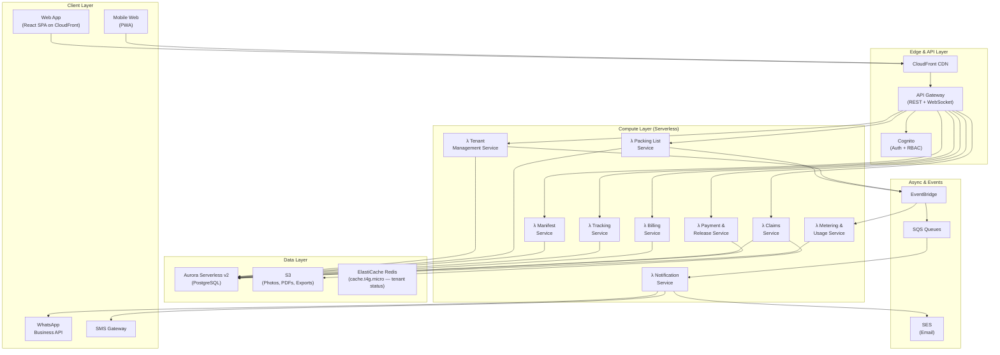
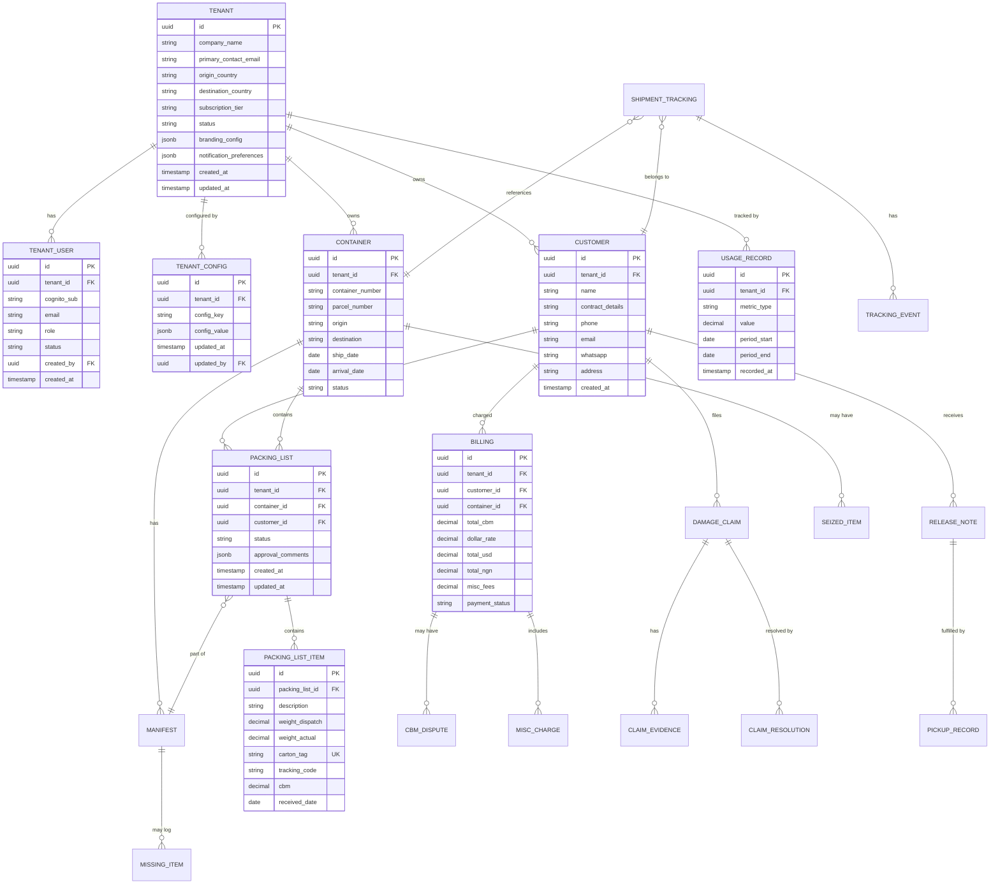
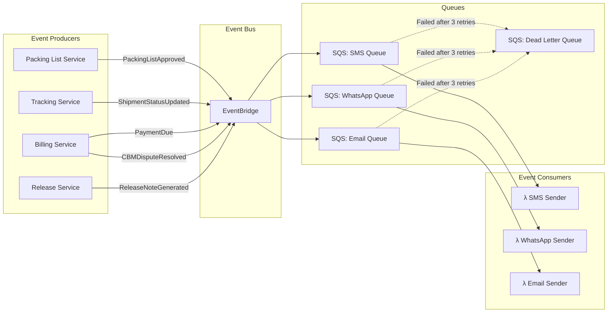
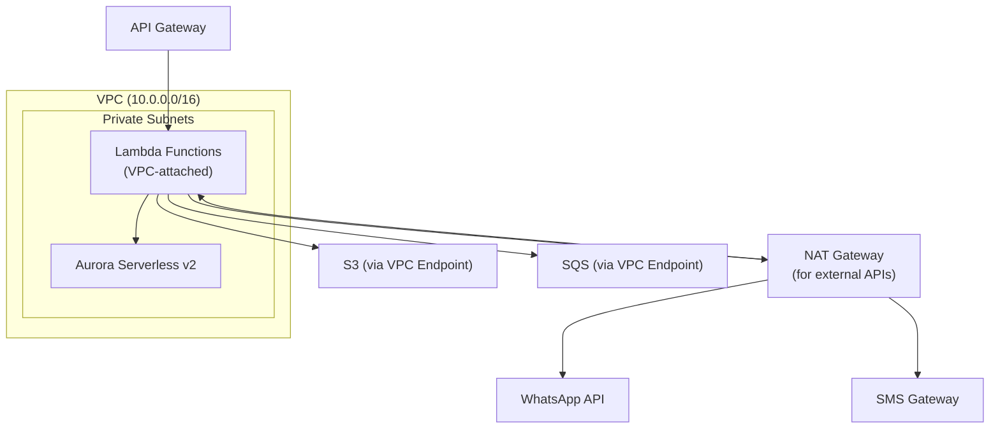
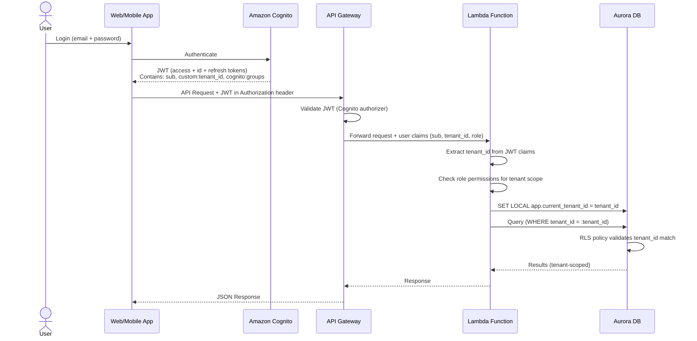

# System Design — Logistics & Cargo Management System

## Cost-Optimized, On-Demand Architecture

| Field | Detail |
|---|---|
| **Document Version** | 3.1 |
| **Date** | 2 March 2026 |
| **Status** | In Development |
| **Design Principle** | Serverless-first, pay-per-use, zero idle cost, multi-tenant SaaS |
| **Target SLA** | 99.5% availability |
| **Reference** | PRD_Logistics_Management_System.md v2.1 (Multi-Tenant SaaS + GDPR) |
| **Changelog** | v3.1: Cognito groups format clarified, GDPR endpoints added to API listing, Python runtime updated, local dev setup added |

---

## 1. Architecture Decision Record (ADR)

### ADR-001: Serverless-First on AWS

**Context:** The platform is a multi-tenant SaaS serving multiple shipping companies, each operating China-to-Nigeria logistics corridors. Per-tenant traffic is bursty (spikes when containers arrive) with long idle periods (containers in transit for weeks). Aggregate traffic across all tenants increases utilization but remains suitable for serverless. The PRD requires 99.5% uptime — achievable without always-on infrastructure.

**Decision:** AWS serverless stack — Lambda + API Gateway + Aurora Serverless + S3 + SQS.

**Rationale:**
| Factor | Always-On (EC2/ECS) | Serverless (Lambda) |
|---|---|---|
| Idle cost | $150–400/mo minimum | $0 when idle |
| Burst handling | Requires auto-scaling config | Automatic, instant |
| Ops overhead | Patching, monitoring, scaling | Managed by AWS |
| Cost at low volume | Fixed regardless of usage | Proportional to requests |

**Trade-offs:**
- (+) Zero cost when no requests — perfect for a logistics business with cyclical demand
- (+) No server management, no patching, no capacity planning
- (+) Automatic scaling during container arrival surges
- (-) Cold start latency (~200-500ms) on first request after idle — acceptable for 2s SLA
- (-) 15-minute execution limit per Lambda — sufficient for all operations
- (-) Vendor lock-in to AWS — mitigated by clean domain layer separation

**Estimated Monthly Cost (low-medium volume):** $30–120/month vs. $300–800/month for container-based deployment.

### ADR-002: Shared-Database Multi-Tenancy with Row-Level Isolation

**Context:** The PRD (v2.0) defines a multi-tenant SaaS platform serving multiple independent shipping companies. Each tenant requires strict data isolation (FR-TN-005), self-service configuration (FR-TN-009 to FR-TN-013), and independent user management. Three isolation strategies were evaluated.

**Decision:** Shared database with `tenant_id` row-level isolation — all tenants share a single Aurora Serverless v2 instance with mandatory `tenant_id` scoping on every query.

**Rationale:**
| Factor | DB-per-Tenant | Schema-per-Tenant | Shared DB + Row Isolation |
|---|---|---|---|
| Isolation strength | Strongest | Strong | Application-enforced |
| Cost at 5–50 tenants | $43–2,150/mo (one Aurora per tenant) | Moderate (schema overhead) | $43–86/mo (single Aurora) |
| Onboarding speed | Minutes (provision new DB) | Seconds (create schema) | Seconds (insert tenant row) |
| Ops complexity | High (N databases) | Moderate | Low (single DB) |
| Cross-tenant analytics | Hard (federated queries) | Moderate | Easy (Platform Admin queries) |

**Trade-offs:**
- (+) Lowest cost — single database instance shared across all tenants
- (+) Fastest tenant onboarding — no infrastructure provisioning required (FR-TN-001)
- (+) Simplest operations — one database to back up, monitor, and scale
- (+) Platform Admin can run cross-tenant analytics easily (FR-TN-014)
- (-) Isolation is application-enforced — a missing `WHERE tenant_id = :tid` leaks data
- (-) Noisy neighbor risk — one tenant's heavy query can affect others
- (-) Requires rigorous automated testing for tenant isolation (FR-TN-006)

**Mitigations:**
- Mandatory `tenant_id` parameter in all repository layer functions — enforced via code review and automated tests
- PostgreSQL Row-Level Security (RLS) policies as a defense-in-depth layer
- Automated cross-tenant access tests in CI pipeline (FR-TN-006)
- Per-tenant connection pooling limits via RDS Proxy to prevent noisy neighbor

### ADR-003: Tenant-Aware Authentication with Cognito Custom Claims

**Context:** Multi-tenancy requires every authenticated request to carry the user's `tenant_id` alongside their role. The system must prevent users from accessing data outside their tenant boundary.

**Decision:** Embed `tenant_id` as a custom claim in Cognito JWT tokens. Lambda functions extract `tenant_id` from the JWT and pass it to the repository layer for all database queries.

**Rationale:**
- Single Cognito User Pool with tenant grouping (vs. one pool per tenant) — simplifies management, supports up to 50 tenants without hitting AWS limits
- Custom attribute `custom:tenant_id` set at user creation, immutable by the user
- Platform Admin users have a special `tenant_id = PLATFORM` value granting cross-tenant access
- JWT claims validated at API Gateway level before reaching Lambda

**Portability note (2026-10-05):** this auth model is kept but made cloud-portable — see **ADR-004** (`docs/adr/004-cognito-to-entra-portability.md`) for the `IdentityProvider` port + Cognito→Entra claim-mapping and user-migration plan. The rest of the backend already runs on cloud-neutral ports (`shared/providers/`, `CLOUD_PROVIDER`); Cognito is the one remaining AWS-specific touchpoint.

---

## 2. High-Level Architecture



---

## 3. Component Design

### 3.1 Client Layer

| Component | Technology | Cost Model | Justification |
|---|---|---|---|
| **Web Application** | React SPA (or Next.js static export) | S3 + CloudFront — ~$1-5/mo | Static hosting is nearly free; CDN ensures low latency for both China and Nigeria users |
| **Mobile Access** | Progressive Web App (PWA) | Included in web deployment | Meets NFR for mobile access; works offline for low-bandwidth warehouse environments |
| **WhatsApp Integration** | WhatsApp Business API (via Meta Cloud API) | Per-conversation pricing (~$0.02-0.08/msg) | Required by PRD for customer notifications |
| **SMS Integration** | Africa's Talking (Nigeria) / Twilio (China) | Per-message (~$0.01-0.05/msg) | Required by PRD for payment notifications and tracking updates |

**Low-bandwidth support (NFR):** PWA with service workers enables offline-first capability for warehouse staff. Data syncs when connectivity returns.

### 3.2 Edge & API Layer

#### API Gateway (Amazon API Gateway — HTTP API)

- **Cost:** $1.00 per million requests + data transfer
- **Why HTTP API over REST API:** 70% cheaper, sufficient for this use case
- **Rate Limiting:** Built-in throttling per API key (protects against abuse)
- **CORS:** Configured for web client origins

```
Base URL: https://api.logistics.example.com/v1

Platform Admin Endpoints (tenant_id = PLATFORM):
  /platform/tenants                POST, GET, GET/{id}, PATCH/{id}, DELETE/{id}
  /platform/tenants/{id}/suspend   PATCH
  /platform/tenants/{id}/activate  PATCH
  /platform/tenants/{id}/usage     GET
  /platform/dashboard              GET (cross-tenant metrics)
  /platform/settings               GET, PUT
  /platform/audit-log              GET

Tenant Admin Endpoints (scoped to caller's tenant_id):
  /tenant/config                   GET, PUT (branding, notification prefs)
  /tenant/users                    POST, GET, GET/{id}, PATCH/{id}, DELETE/{id}
  /tenant/dollar-rate              GET, PUT
  /tenant/charge-types             POST, GET, PUT/{id}, DELETE/{id}
  /tenant/reports                  GET

Tenant-Scoped Operational Endpoints (all scoped by tenant_id from JWT):
  /customers              POST, GET, GET/{id}, PATCH/{id}
  /customers/{id}         DELETE (GDPR Art. 17 — anonymise PII in place)
  /customers/{id}/export  GET    (GDPR Art. 20 — full data portability bundle)
  /packing-lists          POST, GET, GET/{id}, PUT/{id}, PATCH/{id}/approve, PATCH/{id}/reject
  /manifests              POST, GET, GET/{id}, PATCH/{id}/verify
  /shipments              GET, GET/{tracking-code}, PATCH/{id}/status
  /billing                GET/{customer-id}, POST/{id}/dispute
  /claims                 POST, GET, GET/{id}, PATCH/{id}/inspect, PATCH/{id}/resolve
  /claims/missing-items   POST, PATCH/{id}
  /claims/seized-items    POST, PATCH/{id}
  /release-notes          POST, GET/{id}, PATCH/{id}/release
  /payments               POST/{id}/confirm
  /notifications          POST/send (internal)
  /uploads/presigned-url  POST (for damage photo uploads)
  /refunds                POST, GET, GET/{id}, PATCH/{id}/review, PATCH/{id}/approve, PATCH/{id}/reject
```

> **Tenant scoping:** Every operational endpoint extracts `tenant_id` from the JWT `custom:tenant_id` claim. This value is injected into all database queries automatically by the repository layer. No endpoint accepts `tenant_id` as a path or query parameter — preventing tenant ID spoofing.

#### Authentication & Authorization (Amazon Cognito)

- **Cost:** Free tier covers 50,000 MAU — sufficient for up to ~50 tenants
- **User Pool:** Single shared Cognito User Pool for all tenants
- **Custom Attributes:** `custom:tenant_id` (immutable after creation), `custom:role`
- **Cognito Groups:** Used for role-based access control; group names follow `{tenant_id}:{role}` format (e.g., `{tenant_id}:nigeria_office_staff`, `{tenant_id}:tenant_admin`). **Exception:** Platform Admin group is just `"platform_admin"` with no tenant prefix.
- **JWT Claims:** Every token includes `custom:tenant_id` and `cognito:groups` — Lambda authorizer validates both
- **Platform Admin:** `custom:tenant_id = "PLATFORM"`, `cognito:groups = "platform_admin"` — bypasses per-tenant active/suspended check in auth middleware
- **Mutable user attributes:** Only `name` (full_name) and `custom:role` can be updated via `AdminUpdateUserAttributes`. Email is the Cognito `Username` and is immutable after creation.

**Multi-Tenant User Provisioning Flow:**
1. Platform Admin creates tenant → `TENANT` record inserted in DB
2. Platform Admin creates initial Tenant Admin user → Cognito user created with `custom:tenant_id = {tenant_id}`
3. Tenant Admin creates their own staff/customer users → Cognito users created with the same `tenant_id`
4. Users cannot change their own `tenant_id` — enforced by Cognito attribute mutability settings

| Role | Tenant Scope | Access Scope |
|---|---|---|
| **Platform Admin** | Cross-tenant (`PLATFORM`) | Tenant CRUD, platform settings, cross-tenant dashboard, platform audit log |
| **Tenant Admin** | Single tenant | All resources within tenant + dollar rate + user management + branding + reports + refund approvals |
| **China Office Staff** | Single tenant | Packing lists (CRUD), Manifests (CRUD), CBM disputes (investigate), Tracking (update China stages) |
| **Nigeria Office Staff** | Single tenant | Manifests (read/verify), Packing lists (distribute), Tracking (update Nigeria stages), Claims (manage), Release notes (generate) |
| **Warehouse Attendant** | Single tenant | Release notes (verify), Pickup records (create) |
| **Customer** | Single tenant | Own packing lists (read), Own tracking (read), Disputes (create), Claims (create), Payments (confirm) |

### 3.3 Compute Layer — Lambda Functions

Each domain service is a separate Lambda function (or small group of functions). This follows the **Single Responsibility Principle** and allows independent scaling and deployment.

#### Runtime & Configuration

| Setting | Value | Rationale |
|---|---|---|
| Runtime | Python 3.13 (Lambda: 3.12) | Local dev uses 3.13; Lambda deployment targets 3.12 ARM64 |
| Memory | 256–512 MB | Sufficient for CRUD + light computation; keeps cost low |
| Timeout | 30 seconds (API), 5 minutes (async) | Well within limits; API responses < 2s per NFR |
| Provisioned Concurrency | 0 (none) | Cost optimization — accept cold starts of ~300ms |
| Layers | Shared layer for DB driver, auth utils, response formatting | Reduces deployment size, faster cold starts |

#### Service Breakdown

**λ Tenant Management Service**
- Onboards new tenants: creates `TENANT` record, provisions initial Tenant Admin in Cognito (FR-TN-001, FR-TN-002)
- Manages tenant lifecycle: activate, suspend, offboard (FR-TN-003, FR-TN-004)
- Handles tenant configuration: branding, notification preferences, custom charge types (FR-TN-009 to FR-TN-013)
- Manages tenant user CRUD: creates Cognito users with `custom:tenant_id`, assigns roles within tenant scope
- On tenant creation → publishes `TenantOnboarded` event to EventBridge
- On tenant suspension → publishes `TenantSuspended` event (triggers notification to tenant admin)
- Platform Admin dashboard: aggregates cross-tenant metrics (FR-TN-014)
- Estimated invocations: ~100-500/month → **cost: < $0.01/month**

**λ Metering & Usage Service** (async, triggered by EventBridge)
- Tracks per-tenant resource consumption: API calls, containers processed, storage used, users active (FR-TN-015)
- Records usage events from all other services via EventBridge
- Aggregates daily/monthly usage summaries per tenant
- Enforces usage limits: returns 429 if tenant exceeds tier limits (max containers/month, max users, storage quota)
- Provides usage data for Platform Admin dashboard and future billing
- Estimated invocations: ~1,000-5,000/month → **cost: < $0.02/month**

**λ Packing List Service**
- Creates, updates, approves/rejects packing lists
- Groups items by customer + date (FR-PL-004)
- On approval → publishes `PackingListApproved` event to EventBridge
- Estimated invocations: ~500-2,000/month → **cost: < $0.01/month**

**λ Manifest Service**
- Generates container manifests from approved packing lists
- Handles verification and discrepancy logging (FR-MF-004 to FR-MF-006)
- Supports repacking audit trail
- Estimated invocations: ~200-500/month → **cost: < $0.01/month**

**λ Tracking Service**
- Manages shipment stage transitions (8 stages per FR-TR-001)
- On status change → publishes `ShipmentStatusUpdated` event
- Serves customer tracking queries by tracking code
- Estimated invocations: ~2,000-10,000/month → **cost: < $0.05/month**

**λ Billing Service**
- Calculates CBM-based pricing with dynamic dollar rate
- Handles CBM dispute lifecycle (FR-BL-005 to FR-BL-008)
- Maintains audit trail of corrections
- Estimated invocations: ~500-2,000/month → **cost: < $0.01/month**

**λ Claims Service**
- Manages damage claims, missing items, seized items
- Generates presigned S3 URLs for photo uploads
- Handles resolution workflow (refund/discount/no action)
- Estimated invocations: ~100-500/month → **cost: < $0.01/month**

**λ Payment & Release Service**
- Confirms payments, generates release notes
- Manages warehouse pickup flow
- Captures delegate details for third-party pickups (FR-PR-006)
- Estimated invocations: ~500-2,000/month → **cost: < $0.01/month**

**λ Notification Service** (async, triggered by SQS)
- Sends SMS, WhatsApp, and email notifications
- Triggered by events: packing list approved, shipment status change, payment due, release note generated
- Retries on failure with SQS dead-letter queue
- Estimated invocations: ~5,000-20,000/month → **cost: < $0.10/month**

### 3.4 Data Layer

#### Primary Database — Aurora Serverless v2 (PostgreSQL)

**Why Aurora Serverless v2:**
- Scales to zero ACU (0.5 ACU minimum when active) — **no cost when paused**
- Auto-pause after 5 minutes of inactivity (configurable)
- Scales up instantly when requests arrive
- PostgreSQL compatibility for relational data with JSONB for flexible fields
- Encrypted at rest (AES-256) per NFR

**Cost:** ~$0.12/ACU-hour × 0.5 ACU minimum = **~$43/month when active, $0 when paused**

> **Cost optimization note:** For even lower cost, consider **Neon Serverless PostgreSQL** (free tier: 0.5 GB storage, 190 compute hours/month) or **PlanetScale** as alternatives that truly scale to zero. Aurora Serverless v2 has a 0.5 ACU minimum when not paused.

#### Entity-Relationship Model



#### Key Indexes

```sql
-- Tenant-scoped high-frequency queries (tenant_id is leading column for partition pruning)
CREATE INDEX idx_packing_list_tenant_customer ON packing_list(tenant_id, customer_id);
CREATE INDEX idx_packing_list_tenant_container ON packing_list(tenant_id, container_id);
CREATE INDEX idx_packing_list_tenant_status ON packing_list(tenant_id, status);
CREATE INDEX idx_tracking_tenant_code ON shipment_tracking(tenant_id, tracking_code);
CREATE INDEX idx_tracking_tenant_customer ON shipment_tracking(tenant_id, customer_id);
CREATE INDEX idx_billing_tenant_customer ON billing(tenant_id, customer_id);
CREATE INDEX idx_billing_tenant_payment ON billing(tenant_id, payment_status);
CREATE INDEX idx_release_note_tenant_customer ON release_note(tenant_id, customer_id);
CREATE INDEX idx_container_tenant ON container(tenant_id);
CREATE INDEX idx_customer_tenant ON customer(tenant_id);

-- Carton tags unique within tenant scope (FR-TN-007)
CREATE UNIQUE INDEX idx_carton_tag_tenant ON packing_list_item(carton_tag)
  WHERE carton_tag IS NOT NULL;
-- Note: carton_tag uniqueness is enforced at app layer with tenant_id prefix

-- Tenant management indexes
CREATE INDEX idx_tenant_user_tenant ON tenant_user(tenant_id);
CREATE INDEX idx_tenant_status ON tenant(status);
CREATE INDEX idx_usage_record_tenant_period ON usage_record(tenant_id, period_start);
```

#### PostgreSQL Row-Level Security (Defense-in-Depth)

RLS policies provide a database-level safety net in addition to application-layer tenant scoping. Even if a Lambda function has a bug that omits the `tenant_id` filter, RLS prevents data leakage.

```sql
-- Enable RLS on all tenant-scoped tables
ALTER TABLE customer ENABLE ROW LEVEL SECURITY;
ALTER TABLE container ENABLE ROW LEVEL SECURITY;
ALTER TABLE packing_list ENABLE ROW LEVEL SECURITY;
ALTER TABLE billing ENABLE ROW LEVEL SECURITY;
ALTER TABLE shipment_tracking ENABLE ROW LEVEL SECURITY;
ALTER TABLE damage_claim ENABLE ROW LEVEL SECURITY;
ALTER TABLE release_note ENABLE ROW LEVEL SECURITY;
-- ... (all tenant-scoped tables)

-- RLS policy: each query must set the session variable 'app.current_tenant_id'
CREATE POLICY tenant_isolation ON customer
  USING (tenant_id = current_setting('app.current_tenant_id')::uuid);

CREATE POLICY tenant_isolation ON container
  USING (tenant_id = current_setting('app.current_tenant_id')::uuid);

-- Repeat for all tenant-scoped tables...

-- Lambda sets the session variable before each query:
-- SET LOCAL app.current_tenant_id = '{tenant_id_from_jwt}';
```

#### File Storage — Amazon S3 (Tenant-Partitioned per FR-TN-008)

All file storage is partitioned by `tenant_id` to enforce tenant data isolation at the storage layer:

- **Damage photos:** `s3://logistics-assets/{tenant-id}/claims/{claim-id}/`
- **Generated PDFs:** `s3://logistics-assets/{tenant-id}/documents/{type}/{id}.pdf`
- **Excel exports:** `s3://logistics-assets/{tenant-id}/exports/{date}/`
- **Tenant branding assets:** `s3://logistics-assets/{tenant-id}/branding/`
- **Cost:** $0.023/GB/month — negligible for document storage
- **Upload flow:** Lambda generates presigned URL scoped to the tenant's S3 prefix → client uploads directly to S3 → avoids Lambda data transfer costs
- **Access control:** S3 bucket policy restricts presigned URLs to the caller's `{tenant-id}/` prefix — prevents cross-tenant file access
- **Tenant offboarding:** Data export generates a complete archive from `{tenant-id}/` prefix; subsequent deletion removes the entire prefix (FR-TN-004)

#### Caching

**Tenant status cache — ElastiCache Redis (`cache.t4g.micro`, ~$11.52/month):**
- Stores `active` / `suspended` / `offboarded` per tenant with 60-second TTL.
- Shared across all Lambda instances — a suspension or offboarding takes effect across the fleet within 60s (immediately if the explicit cache delete fires on status change).
- Implemented in `shared/distributed_cache.py`. Endpoint injected as `REDIS_HOST` env var.
- Fail-soft: Redis unavailability causes DB fallback, not a 500.

**Tenant config cache — in-memory per Lambda instance (`shared/cache.py`):**
- Dollar rate, CBM rate, storage fee settings. 60-second TTL. Eventual consistency acceptable.

**Future caching (Phase 2):**
- Tracking code lookups if query volume exceeds ~100 req/min — extend Redis usage.

### 3.5 Async & Event Layer

#### Event-Driven Architecture



**Key Events:**

All events carry `tenant_id` as a top-level attribute for routing and isolation.

| Event | Trigger | Actions | Tenant Context |
|---|---|---|---|
| `TenantOnboarded` | Platform Admin creates tenant | Provision Cognito user, send welcome email | Platform-level |
| `TenantSuspended` | Platform Admin suspends tenant | Notify Tenant Admin, disable API access | Platform-level |
| `PackingListApproved` | Packing list approved | Email to tenant's global company address, notify Nigeria office | Tenant-scoped |
| `ShipmentStatusUpdated` | Tracking stage changes | SMS + WhatsApp to customer (using tenant's notification config) | Tenant-scoped |
| `PaymentDue` | Container arrives, billing calculated | SMS + WhatsApp with amount + warehouse address | Tenant-scoped |
| `CBMDisputeResolved` | Dispute resolved | SMS + WhatsApp with updated billing | Tenant-scoped |
| `ReleaseNoteGenerated` | Payment confirmed | SMS + WhatsApp + Email with release note (tenant-branded) | Tenant-scoped |
| `DamageClaimFiled` | Customer files claim | Email to tenant's Nigeria office for investigation | Tenant-scoped |
| `UsageRecorded` | Any billable action | Metering service records per-tenant usage | Tenant-scoped |

**Why SQS + EventBridge (not SNS):**
- SQS provides guaranteed delivery with retries and dead-letter queues
- EventBridge enables content-based routing (e.g., route only Nigeria events to Nigeria staff)
- Both are serverless and cost $0 at low volume (SQS: first 1M requests/month free)

---

## 4. Infrastructure Architecture

### 4.1 Network Design



**Cost Optimization — NAT Gateway:**
NAT Gateway costs ~$32/month + data transfer. To minimize:
- Use **VPC Endpoints** for S3, SQS, EventBridge, SES (free, avoids NAT)
- Only route external API calls (WhatsApp, SMS, payment gateway) through NAT
- **Alternative:** Use a Lambda outside the VPC for notification functions that call external APIs — eliminates NAT entirely for those functions

> **Recommended approach:** Keep notification Lambda functions **outside the VPC** (they don't need database access). This eliminates the need for a NAT Gateway, saving ~$32/month.

### 4.2 Multi-Region Consideration

The system serves users in **China** and **Nigeria** (different continents, ~200ms base latency).

**v1 approach (cost-optimized):**
- Single region: **eu-west-1 (Ireland)** — geographically midpoint, good latency to both
- CloudFront CDN for static assets — edge caching in both regions
- API latency will be ~100-150ms from either location — acceptable for 2s SLA

**Future (if needed):**
- Add read replicas or API Gateway edge-optimized endpoints
- Consider Lambda@Edge for tracking lookups

### 4.3 Infrastructure as Code (Terraform)

```
infrastructure/
├── main.tf
├── variables.tf
├── outputs.tf
├── modules/
│   ├── api-gateway/
│   ├── lambda/
│   ├── aurora/
│   ├── cognito/
│   ├── s3/
│   ├── sqs/
│   ├── eventbridge/
│   └── cloudfront/
├── environments/
│   ├── dev.tfvars
│   ├── staging.tfvars
│   └── prod.tfvars
```

---

## 5. Security Design

### 5.1 Multi-Tenant Authentication Flow



**Tenant suspension check:** Lambda middleware verifies the tenant's status is `active` before processing any request. If the tenant is suspended (FR-TN-003), the request is rejected with HTTP 403 and a message indicating the account is suspended.

### 5.2 Security Controls

| Layer | Control | Implementation |
|---|---|---|
| **Transport** | TLS 1.2+ everywhere | API Gateway enforces HTTPS; Aurora SSL connections |
| **Authentication** | JWT-based (OAuth 2.0) | Cognito user pool with `custom:tenant_id` claim; MFA optional for admin roles |
| **Authorization** | RBAC + Tenant Scope | Cognito groups → Lambda checks `cognito:groups` + `custom:tenant_id` claims |
| **Tenant Isolation (App)** | Mandatory tenant_id scoping | All repository functions require `tenant_id` parameter; no query executes without it (FR-TN-005) |
| **Tenant Isolation (DB)** | PostgreSQL RLS | Row-Level Security policies enforce `tenant_id` match at database level (defense-in-depth) |
| **Tenant Isolation (Storage)** | S3 prefix partitioning | All files stored under `{tenant-id}/` prefix; presigned URLs scoped to tenant prefix (FR-TN-008) |
| **Tenant Isolation (Tests)** | Automated cross-tenant tests | CI pipeline includes tests that attempt cross-tenant data access — must fail (FR-TN-006) |
| **Data at Rest** | AES-256 encryption | Aurora encryption, S3 default encryption, SQS encryption |
| **Data in Transit** | TLS | All inter-service communication over TLS |
| **Secrets** | AWS Secrets Manager | DB credentials, API keys for WhatsApp/SMS; per-tenant secrets for future per-tenant integrations |
| **Input Validation** | Request validation | API Gateway request validators + Lambda-side validation; tenant_id never accepted from request body/params |
| **Audit Trail** | Full operation logging | Every mutation logged with user_id, tenant_id, timestamp, before/after (NFR) |
| **Platform Audit** | Cross-tenant admin logging | Platform-level actions (tenant CRUD, suspensions) logged in separate `platform_audit_log` table (FR-TN-017) |
| **Row-Level Security** | Customer data isolation | Lambda queries include `WHERE tenant_id = :tid AND customer_id = :caller_id` for customer role |
| **Rate Limiting** | Tiered API throttling | Platform-wide: 1000 req/s; per-tenant: 100 req/s; per-customer API key: 10 req/s |

### 5.3 Multi-Tenant Data Isolation (FR-TN-005, FR-TN-006)

Data isolation is enforced at **four layers** — defense-in-depth ensures no single bug can cause cross-tenant data leakage:

#### Layer 1: JWT Claims (Identity Layer)
- Cognito JWT contains immutable `custom:tenant_id` — users cannot modify it
- API Gateway authorizer validates JWT signature and extracts tenant context
- Platform Admin has `tenant_id = PLATFORM` and can specify target tenant in request

#### Layer 2: Application Layer (Lambda)
- Shared `auth.py` middleware extracts `tenant_id` from JWT and injects it into request context
- All repository functions have a mandatory `tenant_id` parameter — enforced by type hints and code review
- **Tenant suspension check:** Middleware queries tenant status; suspended tenants get HTTP 403

```python
# shared/auth.py — Tenant context middleware
def get_tenant_context(event: dict) -> TenantContext:
    claims = event["requestContext"]["authorizer"]["claims"]
    tenant_id = claims["custom:tenant_id"]
    role = claims["cognito:groups"]
    if tenant_id == "PLATFORM":
        return PlatformAdminContext(actor_id=claims["sub"])
    # Verify tenant is active (cached, TTL 60s)
    if not is_tenant_active(tenant_id):
        raise TenantSuspendedError(tenant_id)
    return TenantContext(tenant_id=tenant_id, actor_id=claims["sub"], role=role)
```

#### Layer 3: Database Layer (PostgreSQL RLS)
- Every query session sets `SET LOCAL app.current_tenant_id = :tenant_id`
- RLS policies on all tenant-scoped tables enforce the match — even if the application layer has a bug

#### Layer 4: Storage Layer (S3 Prefix Isolation)
- All presigned URLs are scoped to `{tenant-id}/` prefix
- S3 bucket policy denies access to keys outside the tenant's prefix

#### Customer Isolation (Within a Tenant)
Customers must only see their own data within their tenant (FR-PL-011):

```sql
SELECT * FROM packing_list
WHERE tenant_id = :tenant_id_from_jwt
AND customer_id = :authenticated_customer_id
AND container_id = :requested_container_id
```

#### Cross-Tenant Isolation Testing (FR-TN-006)
The CI pipeline includes automated tests that:
1. Create two test tenants (A and B) with data
2. Authenticate as Tenant A user and attempt to query Tenant B data
3. Verify all queries return empty results (not errors — to prevent tenant enumeration)
4. Attempt direct DB queries without setting `app.current_tenant_id` — verify RLS blocks them
5. Attempt S3 presigned URL access to another tenant's prefix — verify access denied

---

## 6. Notification Architecture

### 6.1 Channel Strategy

| Event | SMS | WhatsApp | Email |
|---|---|---|---|
| Packing list ready | — | ✓ (with PDF) | ✓ (to company global) |
| Shipment status update | ✓ | ✓ | — |
| Payment notification | ✓ | ✓ | — |
| CBM dispute update | — | ✓ | — |
| Release note generated | ✓ | ✓ | ✓ |
| Damage claim update | — | ✓ | ✓ (to office) |

### 6.2 WhatsApp Integration (Tenant-Branded)

```mermaid
sequenceDiagram
    participant Lambda as Notification Lambda
    participant DB as Tenant Config DB
    participant SQS as WhatsApp Queue
    participant WA as WhatsApp Cloud API

    Lambda->>DB: Fetch tenant notification config (tenant_id)
    DB-->>Lambda: Tenant branding (company name, WABA credentials)
    Lambda->>SQS: Enqueue message (template + parameters + tenant branding)
    SQS->>Lambda: Trigger WhatsApp sender
    Lambda->>WA: POST /v17.0/{phone-id}/messages<br/>(using tenant's WABA or platform shared WABA)
    WA-->>Lambda: 200 OK (message_id)
    Lambda->>Lambda: Log delivery status with tenant_id

    Note over Lambda,WA: Template messages pre-approved by Meta;<br/>tenant company name injected into templates
```

**Pre-approved message templates (tenant-branded):**
- `shipment_update`: "{{company_name}}: Your shipment {{tracking_code}} is now {{status}}. Track: {{url}}"
- `payment_due`: "{{company_name}}: Container {{container}} has arrived. Amount due: {{currency}} {{amount}}. Pickup at: {{address}}"
- `release_ready`: "{{company_name}}: Your release note is ready. Reference: {{ref}}. Present at warehouse to collect {{carton_count}} cartons."

**Per-tenant WhatsApp strategy (FR-TN-011):**
- **v1:** Shared platform WhatsApp Business Account with `{{company_name}}` variable in templates — all tenants share one WABA
- **Future:** Per-tenant WABA — each tenant provides their own WhatsApp Business Account credentials stored in AWS Secrets Manager, enabling tenant-specific phone numbers and verified business names

### 6.3 SMS Integration (Africa's Talking)

- Primary for Nigerian customers (reliable, works on feature phones)
- Fallback when WhatsApp delivery fails
- Cost: ~₦4/SMS (~$0.003)

---

## 7. Data Export & Excel Compatibility

Per NFR and constraint (existing Excel workflows must be supported):

| Export | Format | Generation |
|---|---|---|
| Packing List | PDF + Excel (.xlsx) | Lambda generates via `openpyxl` / `reportlab` |
| Manifest | PDF + Excel | Lambda generates on demand |
| Release Note | PDF | Lambda generates, stored in S3 |
| Reports | Excel + CSV | Lambda generates, S3 presigned URL for download |

**Excel Import:** Lambda function accepts `.xlsx` upload, parses with `openpyxl`, validates, and creates packing list entries. Supports migration from existing workflows.

---

## 8. Observability

### 8.1 Monitoring Stack (Serverless-Native)

| Concern | Tool | Cost |
|---|---|---|
| **Logs** | CloudWatch Logs | Pay per GB ingested (~$0.50/GB) |
| **Metrics** | CloudWatch Metrics | Free tier covers basic Lambda metrics |
| **Tracing** | AWS X-Ray | Free tier: 100,000 traces/month |
| **Alerts** | CloudWatch Alarms | $0.10/alarm/month |
| **Dashboard** | CloudWatch Dashboard | $3/dashboard/month |

### 8.2 Key Alarms

| Alarm | Threshold | Action |
|---|---|---|
| Lambda errors | > 5 errors in 5 minutes | SNS → email to dev team |
| API Gateway 5xx | > 1% of requests | SNS → email to dev team |
| Aurora connections | > 80% max connections | Scale ACU or investigate |
| SQS DLQ messages | > 0 messages | Notification delivery failure — investigate |
| Lambda duration | p95 > 5 seconds | Performance degradation alert |

### 8.3 Audit Trail Implementation (Multi-Tenant)

Every mutation is logged to a tenant-scoped `audit_log` table. Tenant Admins can view their tenant's audit log; Platform Admins can view cross-tenant.

```sql
-- Tenant-scoped audit log (for operational actions within a tenant)
CREATE TABLE audit_log (
    id UUID PRIMARY KEY DEFAULT gen_random_uuid(),
    tenant_id UUID NOT NULL REFERENCES tenant(id),  -- tenant scope
    entity_type VARCHAR(50) NOT NULL,  -- 'packing_list', 'billing', etc.
    entity_id UUID NOT NULL,
    action VARCHAR(20) NOT NULL,       -- 'CREATE', 'UPDATE', 'DELETE'
    actor_id UUID NOT NULL,            -- Cognito user sub
    actor_role VARCHAR(30) NOT NULL,
    before_state JSONB,
    after_state JSONB,
    ip_address INET,
    created_at TIMESTAMPTZ DEFAULT NOW()
);

CREATE INDEX idx_audit_tenant_entity ON audit_log(tenant_id, entity_type, entity_id);
CREATE INDEX idx_audit_tenant_actor ON audit_log(tenant_id, actor_id);
CREATE INDEX idx_audit_tenant_created ON audit_log(tenant_id, created_at);

-- RLS on audit_log
ALTER TABLE audit_log ENABLE ROW LEVEL SECURITY;
CREATE POLICY tenant_isolation ON audit_log
  USING (tenant_id = current_setting('app.current_tenant_id')::uuid);
```

```sql
-- Platform-level audit log (for cross-tenant admin actions — FR-TN-017)
CREATE TABLE platform_audit_log (
    id UUID PRIMARY KEY DEFAULT gen_random_uuid(),
    action VARCHAR(50) NOT NULL,       -- 'TENANT_CREATED', 'TENANT_SUSPENDED', 'SETTINGS_UPDATED'
    actor_id UUID NOT NULL,            -- Platform Admin Cognito sub
    target_tenant_id UUID,             -- Affected tenant (null for platform-wide actions)
    details JSONB NOT NULL,            -- Action-specific details
    ip_address INET,
    created_at TIMESTAMPTZ DEFAULT NOW()
);

CREATE INDEX idx_platform_audit_actor ON platform_audit_log(actor_id);
CREATE INDEX idx_platform_audit_tenant ON platform_audit_log(target_tenant_id);
CREATE INDEX idx_platform_audit_created ON platform_audit_log(created_at);

-- Platform audit log is NOT tenant-scoped — only accessible to Platform Admins
```

---

## 9. CI/CD Pipeline

```mermaid
flowchart LR
    subgraph Dev["Development"]
        CODE["Push to GitHub"]
        PR["Pull Request"]
    end

    subgraph CI["CI (GitHub Actions)"]
        LINT["Lint + Type Check"]
        TEST["Unit Tests<br/>(pytest)"]
        SEC["Security Scan<br/>(bandit + safety)"]
    end

    subgraph CD["CD (GitHub Actions)"]
        TF_PLAN["Terraform Plan"]
        TF_APPLY["Terraform Apply"]
        DEPLOY["SAM / CDK Deploy<br/>(Lambda + API GW)"]
        SMOKE["Smoke Tests"]
    end

    subgraph Envs["Environments"]
        DEV_ENV["Dev"]
        STG["Staging"]
        PROD["Production"]
    end

    CODE --> PR --> LINT --> TEST --> SEC
    SEC -->|Pass| TF_PLAN --> TF_APPLY --> DEPLOY --> SMOKE
    SMOKE --> DEV_ENV -->|Manual promote| STG -->|Manual approve| PROD
```



**Pipeline cost:** GitHub Actions free tier (2,000 minutes/month) — sufficient for this project.

---

## 10. Cost Estimate (Monthly)

### Low Volume (5 tenants, ~25 containers/month total, ~250 customers across all tenants)

| Component | Monthly Cost | Notes |
|---|---|---|
| **Lambda** | $1–3 | ~100,000 invocations (includes tenant mgmt + metering), 256MB, avg 200ms |
| **API Gateway** | $1 | ~100,000 requests |
| **Aurora Serverless v2** | $20–50 | 0.5 ACU; paused ~50% of time; shared across all tenants |
| **S3** | $2 | < 10 GB storage (tenant-partitioned) + requests |
| **CloudFront** | $2 | < 20 GB transfer (serves all tenants) |
| **Cognito** | $0 | < 50,000 MAU — single pool for all tenants (free tier) |
| **SQS + EventBridge** | $0 | Free tier covers volume (events include tenant_id routing) |
| **CloudWatch** | $5 | Logs + 1 dashboard (tenant-tagged metrics) |
| **SES (Email)** | $0.50 | < 5,000 emails across all tenants |
| **Secrets Manager** | $3 | 7 secrets (DB, SMS, WhatsApp, platform keys) × $0.40 |
| **SMS (Africa's Talking)** | $15–40 | ~3,000–10,000 messages across tenants |
| **WhatsApp Cloud API** | $25–75 | ~1,500–5,000 conversations across tenants |
| **Domain + Route 53** | $1.50 | 1 hosted zone + domain (shared platform domain) |
| **NAT Gateway** | $0 | Notification Lambdas outside VPC |
| **TOTAL** | **~$75–185/month** | **~$15–37/month per tenant** |

### Medium Volume (20 tenants, ~100 containers/month total, ~1,000 customers)

| Component | Monthly Cost |
|---|---|
| Lambda | $5–10 |
| API Gateway | $5 |
| Aurora Serverless v2 | $50–120 |
| S3 + CloudFront | $10 |
| SQS + EventBridge | $1–3 |
| CloudWatch | $8 |
| SMS + WhatsApp | $100–250 |
| Secrets Manager | $5 |
| Other | $15 |
| **TOTAL** | **~$200–430/month** | 
| **Per tenant** | **~$10–22/month** |

### High Volume (50 tenants, ~300 containers/month total, ~5,000 customers)

| Component | Monthly Cost |
|---|---|
| Lambda | $15–30 |
| API Gateway | $15 |
| Aurora Serverless v2 | $120–250 |
| S3 + CloudFront | $25 |
| SQS + EventBridge | $5–10 |
| CloudWatch | $15 |
| SMS + WhatsApp | $300–600 |
| Secrets Manager | $8 |
| Other | $25 |
| **TOTAL** | **~$530–980/month** |
| **Per tenant** | **~$11–20/month** |

> **Multi-tenant cost efficiency:** The shared-database, shared-infrastructure model means per-tenant cost *decreases* as more tenants onboard. The fixed costs (Aurora, CloudWatch, Secrets Manager) are amortized across tenants, while variable costs (Lambda, SMS, WhatsApp) scale linearly with actual usage.

### Comparison: Serverless Multi-Tenant vs. Traditional

| | Serverless Multi-Tenant (this design) | Traditional (EC2 + RDS) | DB-per-Tenant |
|---|---|---|---|
| 5 tenants | $75–185/mo | $300–500/mo | $400–1,000/mo |
| 20 tenants | $200–430/mo | $500–900/mo | $1,200–3,000/mo |
| 50 tenants | $530–980/mo | $900–1,500/mo | $3,000–8,000/mo |
| Idle periods | ~$15/mo (DB paused) | $200+/mo (servers running) | $500+/mo |
| Tenant onboarding | Seconds (insert row) | Hours (provision) | Hours (provision DB) |
| Ops effort | Minimal | Per-server patching | Per-database management |

---

## 11. Application Structure

```
logistics-system/
├── infrastructure/              # Terraform IaC
│   ├── modules/
│   │   ├── api-gateway/
│   │   ├── lambda/
│   │   ├── aurora/
│   │   ├── cognito/             # Single user pool with custom:tenant_id attribute
│   │   ├── s3/
│   │   ├── sqs/
│   │   ├── eventbridge/
│   │   └── cloudfront/
│   └── environments/
├── services/                    # Lambda functions (Python)
│   ├── tenant_management/       # NEW: Tenant lifecycle (FR-TN-001 to FR-TN-017)
│   │   ├── handler.py           # Lambda entry point
│   │   ├── service.py           # Tenant CRUD, onboarding, suspension
│   │   ├── repository.py        # Tenant & tenant_user DB queries
│   │   ├── cognito_client.py    # Cognito user provisioning with custom:tenant_id
│   │   └── models.py            # Tenant, TenantUser, TenantConfig Pydantic models
│   ├── metering/                # NEW: Per-tenant usage tracking (FR-TN-015)
│   │   ├── handler.py
│   │   ├── service.py           # Usage aggregation, limit enforcement
│   │   ├── repository.py
│   │   └── models.py
│   ├── packing_list/
│   │   ├── handler.py           # Lambda entry point
│   │   ├── service.py           # Business logic
│   │   ├── repository.py        # Database queries (all scoped by tenant_id)
│   │   └── models.py            # Pydantic models
│   ├── manifest/
│   ├── tracking/
│   ├── billing/
│   ├── claims/
│   ├── payment_release/
│   └── notification/
│       ├── handler.py
│       ├── service.py
│       ├── tenant_branding.py   # NEW: Fetches tenant branding for notifications
│       └── models.py
├── shared/                      # Lambda layer (shared code)
│   ├── db.py                    # Aurora connection pooling (RDS Proxy) + tenant RLS session setup
│   ├── auth.py                  # JWT/role validation + tenant_id extraction + suspension check
│   ├── tenant_context.py        # NEW: TenantContext dataclass, middleware for tenant scoping
│   ├── events.py                # EventBridge publisher (all events include tenant_id)
│   ├── responses.py             # Standardized API responses (RFC 7807)
│   └── models.py                # Shared Pydantic base models (TenantScopedBase with tenant_id)
├── tests/
│   ├── unit/
│   ├── integration/
│   ├── e2e/
│   └── tenant_isolation/        # NEW: Cross-tenant access tests (FR-TN-006)
│       ├── test_db_isolation.py  # Verify RLS blocks cross-tenant queries
│       ├── test_api_isolation.py # Verify API returns empty for wrong tenant
│       └── test_s3_isolation.py  # Verify S3 prefix isolation
├── scripts/
│   ├── migrate.py               # Database migrations (alembic) — includes tenant tables + RLS policies
│   ├── seed.py                  # Seed data for development (multi-tenant seed data)
│   └── onboard_tenant.py        # NEW: CLI script for manual tenant onboarding
├── template.yaml                # SAM template (alternative to Terraform for Lambda)
└── .github/
    └── workflows/
        ├── ci.yml               # Includes tenant isolation tests
        └── deploy.yml
```

---

## 12. Migration Strategy (Excel → Multi-Tenant System)

### 12.1 Platform Deployment

| Phase | Duration | Scope |
|---|---|---|
| **Phase 0** | Week 1 | Deploy platform infrastructure (Aurora, Cognito, API Gateway, Lambda); create Platform Admin account; deploy tenant management service |
| **Phase 1** | Week 2–3 | Onboard pilot tenant (first shipping company); Excel import for existing manifests; validate tenant isolation |
| **Phase 2** | Week 4–5 | Pilot tenant: China office creates packing lists in system; Excel export for Nigeria office backup |
| **Phase 3** | Week 6–7 | Pilot tenant: Nigeria office uses system for tracking + billing; WhatsApp notifications go live |
| **Phase 4** | Week 8 | Pilot tenant: Full digital flow; Excel import/export retained as backup |
| **Phase 5** | Week 9–12 | Onboard additional tenants (target: 5 total); parallel onboarding using automated tenant provisioning |

### 12.2 Per-Tenant Onboarding Flow

Each new tenant follows this automated provisioning sequence:

1. **Platform Admin** creates tenant via `/platform/tenants` API (or CLI script)
2. System creates `TENANT` record with unique `tenant_id` (UUID)
3. System creates initial Tenant Admin user in Cognito with `custom:tenant_id`
4. System creates default `TENANT_CONFIG` records (notification preferences, default charge types)
5. System publishes `TenantOnboarded` event → welcome email sent to Tenant Admin
6. Tenant Admin logs in, configures branding, dollar rate, and creates staff users
7. Tenant Admin imports existing Excel manifests/packing lists via Excel import (tagged with `tenant_id`)
8. **Target:** Tenant operational within 24 hours of onboarding (NFR)

---

## 13. Key Trade-offs & Decisions Summary

| Decision | Chosen | Alternative | Rationale |
|---|---|---|---|
| Cloud provider | AWS | GCP, Azure | Best serverless ecosystem; Aurora Serverless v2 auto-pause |
| Compute | Lambda | ECS Fargate, App Runner | Zero idle cost; bursty traffic pattern |
| Database | Aurora Serverless v2 | Neon, PlanetScale, DynamoDB | Relational model fits data; auto-pause saves cost |
| **Tenant isolation** | **Shared DB + row-level** | **DB-per-tenant, schema-per-tenant** | **Lowest cost ($43 vs $43×N); fastest onboarding; easiest cross-tenant analytics (ADR-002)** |
| **Tenant auth** | **Single Cognito pool + custom:tenant_id** | **Pool-per-tenant** | **Simpler ops; free tier covers 50K MAU across all tenants; custom claims carry tenant context (ADR-003)** |
| **Tenant data safety** | **4-layer defense-in-depth** | **App-layer only** | **RLS + S3 prefix + JWT immutability + automated tests — no single point of failure for data leakage** |
| API style | REST | GraphQL | Simpler for CRUD-heavy workflows; fewer client types |
| Auth | Cognito | Auth0, Clerk | Native AWS integration; free at multi-tenant scale |
| Notifications | SQS + EventBridge | SNS | DLQ support, content-based routing; events carry tenant_id for tenant-scoped processing |
| Frontend | React SPA/PWA | Native apps | Lower cost; PWA handles offline for warehouse; single deployment serves all tenants |
| Region | eu-west-1 | af-south-1, ap-east-1 | Best latency balance between China and Nigeria |
| IaC | Terraform | CDK, SAM | Multi-cloud future option; team preference |

---

## 14. Risks & Mitigations

| Risk | Impact | Mitigation |
|---|---|---|
| **Cross-tenant data leakage** | **Critical — legal, trust, business failure** | **4-layer defense: JWT claims + app scoping + PostgreSQL RLS + S3 prefix isolation; automated cross-tenant tests in CI (FR-TN-006)** |
| **Noisy neighbor (one tenant's heavy load)** | **Performance degradation for other tenants** | **Per-tenant API rate limiting (100 req/s); Aurora auto-scaling; per-tenant usage metering with tier limits; RDS Proxy connection pooling per tenant** |
| **Tenant onboarding failures** | **New tenant cannot start operations** | **Automated onboarding with rollback: if Cognito user creation fails, DB tenant record is rolled back; idempotent retry** |
| Aurora cold start after pause | 25-30s to resume from paused state | Set auto-pause to 10 min (not 5); keep 0.5 ACU minimum during business hours via scheduled scaling; more tenants = less likely to pause |
| WhatsApp API approval delayed | No WhatsApp notifications | SMS-first approach; WhatsApp as enhancement; shared platform WABA for v1 |
| Lambda cold starts | Slightly slower first request | Use Python (fast cold starts); keep deployment packages small; more tenants = warmer Lambdas |
| Nigeria connectivity issues | Warehouse staff can't access system | PWA with offline mode; sync when online |
| Exchange rate volatility | Billing disputes | Tenant Admin sets rate at arrival time; system records rate used per billing record |
| Vendor lock-in (AWS) | Hard to migrate | Clean hexagonal architecture: domain logic decoupled from AWS SDKs; tenant_id scoping is cloud-agnostic |
| **Single Cognito pool capacity** | **50K MAU limit on free tier** | **Monitor MAU growth; at scale, move to Cognito paid tier ($0.0055/MAU) or migrate to Auth0/Clerk** |

---

## 15. Future Enhancements (Post v1)

1. **ElastiCache replication group** — Upgrade from single-node `cache.t4g.micro` to a Multi-AZ replication group for prod HA; extend Redis usage to tracking lookups if volume grows
2. **Lambda@Edge** — Tracking API at edge for lower latency across all tenants
3. **Multi-warehouse support** — Separate warehouse inventories per tenant in Nigeria
4. **In-app payments** — Integrate Paystack/Flutterwave with per-tenant payment gateway credentials
5. **AI-powered CBM estimation** — Use photos to estimate CBM, reducing disputes
6. **Multi-country expansion** — Add routing for Ghana, Kenya destinations; per-tenant corridor configuration
7. **Real-time WebSocket** — Live tracking updates instead of polling (tenant-scoped channels)
8. **Per-tenant WhatsApp Business Accounts** — Each tenant provides their own WABA for branded messaging with verified business name
9. **Usage-based tenant billing** — Automated metering → invoice generation for platform subscription fees (per-container pricing, tiered plans)
10. **Tenant self-service onboarding** — Public signup flow with Stripe/Paystack for subscription payment; automated provisioning without Platform Admin intervention
11. **Per-tenant custom domains** — Vanity URLs (e.g., `tracking.shippingcompany.com`) via CloudFront alternate domain names
12. **Schema-per-tenant migration** — If a high-value tenant requires stronger isolation, migrate them to a dedicated schema within the same Aurora instance

---

## Revision History

| Version | Date | Author | Changes |
|---|---|---|---|
| 1.0 | 15 Feb 2026 | — | Initial system design — serverless-first, cost-optimized |
| 3.0 | 21 Feb 2026 | — | Multi-tenant SaaS redesign: ADR-002 (shared-DB row-level isolation), ADR-003 (Cognito tenant claims); added Tenant Management Service + Metering Service; ER model includes TENANT, TENANT_USER, TENANT_CONFIG, USAGE_RECORD; tenant_id on all entities; PostgreSQL RLS defense-in-depth; 4-layer tenant isolation; tenant-scoped API endpoints (/platform/*, /tenant/*); tenant-branded notifications; platform audit log (FR-TN-017); per-tenant S3 prefix partitioning (FR-TN-008); multi-tenant cost estimates (5/20/50 tenants); automated cross-tenant isolation tests (FR-TN-006); per-tenant onboarding flow; updated risks, trade-offs, and future enhancements for multi-tenancy |
